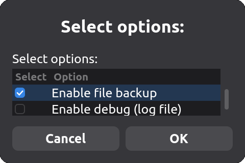
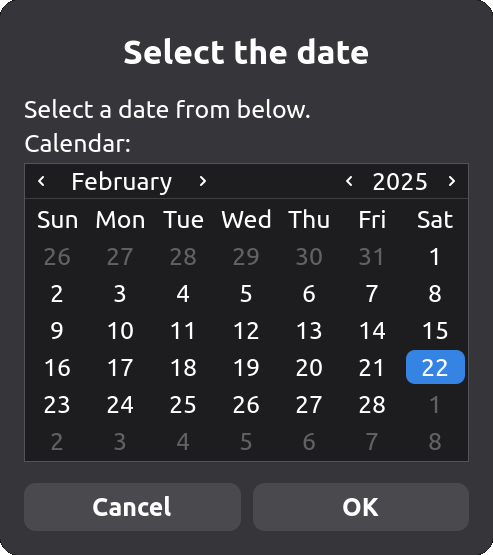
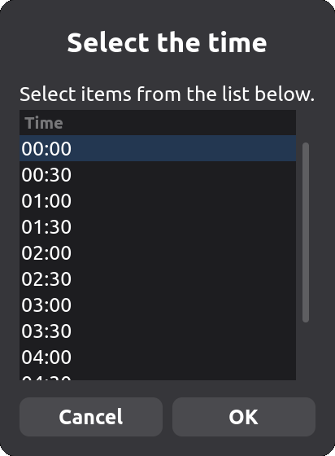
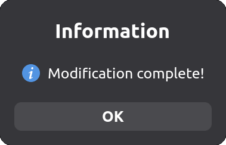

# Change file modification date

A Nemo action to change the **modification date and time** of one or more files, straight from the right-click menu.

Unlike other actions that can only set the date to *now*, this one lets you pick **any date and time**.

## Usage

1. In Nemo, select one or more files.
2. Right-click and choose **Change file modification date**.
3. Choose the options you want:
   - **Enable file backup**: a copy of each file is saved next to it with the `.bkp` extension, before anything is changed.
   - **Enable debug (log file)**: a text log of the old dates is written in the same folder.

   

4. Pick the new date in the calendar.

   

5. Pick the time (30-minute steps, from 00:00 to 23:30).

   

6. Done.

   

Read-only files (`444`) are handled too: their permissions are restored after the change.

## Languages

The menu entry follows the translations of the Cinnamon Spices.
The dialogs are available in English, German and Italian; English is used for any other language.

## Dependencies

- `zenity` (dialogs)
- `coreutils` (`touch`, `stat`, `cp`)

Both are installed by default on Linux Mint.

## Notes

Only the modification date can be changed. Linux file systems do not offer a standard way to set the creation (birth) date of a file.

## License

MIT. See [LICENSE](LICENSE).

## Author

Made with ❤️ by Francesco (FranzBias) - https://github.com/FranzBias
